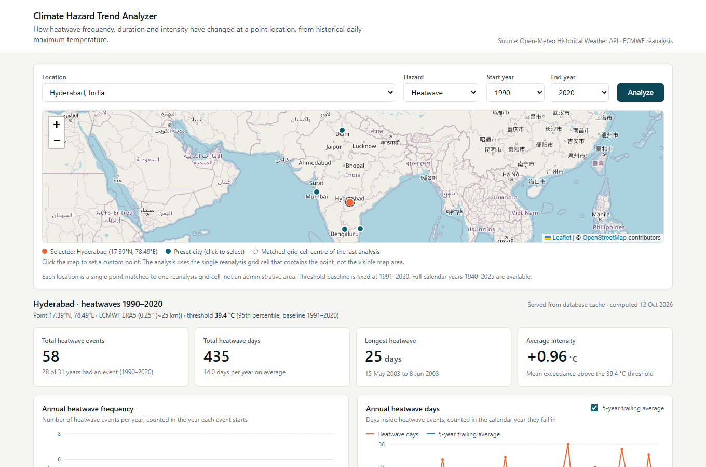
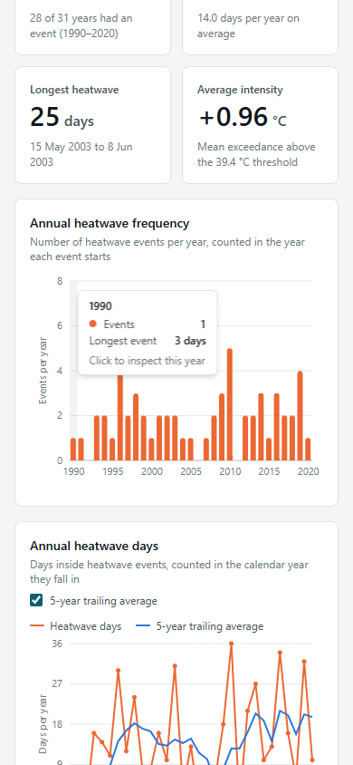
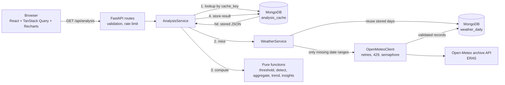

# Climate Hazard Trend Analyzer

A full stack web application that analyses historical daily maximum temperature for a point
location and reports how heatwave **frequency**, **duration** and **intensity** have changed over
time. It fetches ERA5 reanalysis data from the Open-Meteo Historical Weather API, stores it in
MongoDB, detects heatwaves with a documented operational definition, and presents annual charts,
an event table and deliberately cautious trend statements.

## Feature overview

- Five preset cities (Hyderabad, Delhi, Mumbai, Bengaluru, Chennai) plus custom latitude/longitude.
- Interactive map (React Leaflet + OpenStreetMap): click anywhere to set a custom point, or click
  a city marker to select a preset. After an analysis it also marks the centre of the reanalysis
  grid cell that was matched. Everything the map does is also possible from the form fields.
- Heatwave detection against a fixed 1991-2020, 95th percentile threshold.
- Four summary metrics, three annual charts (frequency, heatwave days with optional 5-year trailing
  average, mean/maximum intensity), sortable and paginated event history.
- Click a chart, or use the year selector, to inspect one year; the event table filters to match.
- Insights generated from computed numbers only, with confidence intervals, completeness status and
  explicit caveats. No percentage is produced from a zero baseline; no trend from too few years.
- Two trend methods side by side: linear regression, and the rank-based Mann-Kendall test with the
  Theil-Sen slope.
- Daily records and finished analyses are stored in MongoDB. A repeated request is a cache hit with
  no provider call; an overlapping request downloads only the days not already stored.
- Loading, empty, failed-request and partial-data states. No placeholder or synthetic numbers.
- CSV export of events or the annual table.
- Request validation, rate limiting, strict CORS, no stack traces in responses.

## Screenshots

Captured from the running application with real Open-Meteo data for Hyderabad, 1990-2020.

| Desktop | Mobile |
| --- | --- |
|  |  |

## Architecture



```
backend/
  app/
    main.py                  app factory, CORS, wiring
    config.py                settings from environment variables
    errors.py                error types and safe JSON error responses
    schemas.py               Pydantic request and response models
    locations.py             preset cities
    rate_limit.py            in-memory sliding window limiter
    api/routes.py            HTTP endpoints (no business logic)
    analysis/heatwave.py     PURE: threshold, detection, aggregation, trend, comparison
    analysis/quality.py      PURE: provider payload validation
    analysis/insights.py     PURE: insight wording
    clients/open_meteo.py    async httpx client
    db/mongo.py              connection and indexes
    db/repositories.py       all MongoDB queries
    services/                weather retrieval, analysis orchestration, CSV export
  tests/                     pytest suite (89 tests)
frontend/
  src/api/                   typed API client
  src/hooks/                 TanStack Query hooks
  src/lib/                   formatting, form validation
  src/components/            Dashboard and its parts
  src/test/                  Vitest + Testing Library tests, labelled fixtures
```

## Technology choices and tradeoffs

| Choice | Why | Tradeoff |
| --- | --- | --- |
| FastAPI + Pydantic | Declarative validation, typed response contract, async for the provider call | PyMongo is synchronous, so database calls run in a thread (`asyncio.to_thread`) |
| PyMongo (not Motor) | Requested stack; simplest driver to explain | One thread per database call; fine at this scale |
| Pure analysis module | Detection logic is testable with five-line inputs and no mocks | A small amount of mapping code between records, dataclasses and JSON |
| Plain Python loop for detection | The run-length logic and its edge cases (gaps, nulls, strict `>`) are easy to read and step through; 30 years is about 11,000 rows | Not vectorised; it would need rewriting for gridded data |
| NumPy / SciPy / pandas | Percentile, least squares fit with standard error, rolling mean and CSV | Heavier install than the maths strictly needs |
| ERA5 only | One consistent model from 1940; never mixed with ERA5-Land | 0.25° cells smooth local extremes |
| Analysis cache as a stored JSON document | A cache hit is one indexed read | Changing the response shape requires bumping `ALGORITHM_VERSION` |
| Own rate limiter | About 40 lines, no extra dependency | Per-process only; needs Redis or a gateway when scaled out |
| TanStack Query | Request state, cancellation and client caching without hand-written effects | One more dependency |
| Recharts 2.x | Requested library; stable with React 18 | The 2.x line is in maintenance; v3 is the upgrade path |
| Vite 6 | Vite 7 requires Node 20.19+; this was developed on Node 20.17 | Not the newest major |

## Local setup

Prerequisites: Python 3.11+, Node.js 20+, and a MongoDB connection string
([MongoDB Atlas](https://www.mongodb.com/atlas) free tier or a local `mongod`).

### Backend

```bash
cd backend
python -m venv .venv
# Windows:  .venv\Scripts\activate        macOS/Linux:  source .venv/bin/activate
pip install -r requirements-dev.txt

# Create backend/.env from the BACKEND block of ../.env.example and set MONGODB_URI
uvicorn app.main:app --reload --port 8000
```

Check it: <http://127.0.0.1:8000/api/health> should report `"database": "ok"`. Interactive API
docs are at <http://127.0.0.1:8000/docs> (disabled when `APP_ENV=production`).

### Frontend

```bash
cd frontend
npm install
npm run dev
```

Open <http://localhost:5173>. The Vite dev server proxies `/api` to `http://127.0.0.1:8000`, so no
frontend environment variable is needed locally.

## Environment variables

All are documented with defaults in [.env.example](.env.example). The ones you must set:

| Variable | Where | Purpose |
| --- | --- | --- |
| `MONGODB_URI` | backend | Atlas connection string. Backend only; never exposed to the browser |
| `CORS_ALLOWED_ORIGINS` | backend | Comma separated exact frontend origins. A wildcard is rejected when `APP_ENV=production` |
| `APP_ENV` | backend | `development` or `production` |
| `TRUST_PROXY_HEADERS` | backend | `true` on Render so rate limiting sees the client address |
| `VITE_API_BASE_URL` | frontend | Backend origin in production; empty locally |

Tunable without code changes: `OPEN_METEO_MODEL`, timeouts, retries, backoff, concurrency,
`MAX_REQUEST_SECONDS`, `MAX_YEAR_RANGE`, baseline years, `ANALYSIS_CACHE_TTL_DAYS`,
`RATE_LIMIT_PER_MINUTE`, `COORDINATE_PRECISION`.

## Open-Meteo data source

- Endpoint: `https://archive-api.open-meteo.com/v1/archive` (a constant in code; never built from
  user input).
- Variable: `daily=temperature_2m_max`, `temperature_unit=celsius`.
- Model: `models=era5` for **every** request, baseline and analysis alike. ERA5 is the ECMWF
  reanalysis at 0.25° (roughly 25 km) and is available consistently from 1940. Open-Meteo's default
  "best match" blends ERA5 with higher resolution models for recent years, which would introduce
  an artificial step change into a trend, so it is not used. `era5_land` (0.1°, from 1950) can be
  selected with `OPEN_METEO_MODEL`; the model name is part of the storage key and the cache key, so
  the two are never mixed.
- `timezone=auto`: a "day" is a local calendar day at the location.
- The response is validated before use: `daily_units` must be `°C`, the date and temperature arrays
  must be arrays of equal length, every date must parse and lie inside the requested range, and
  every temperature must be a finite number or `null`.
- Attribution: weather data by [Open-Meteo.com](https://open-meteo.com/) (CC BY 4.0), derived from
  ECMWF/Copernicus ERA5. The free API is for non-commercial use and is rate limited.

## Climate hazard methodology

**Definition.** A heatwave event is a run of **at least 3 consecutive calendar days** whose daily
maximum 2 m air temperature is **strictly greater than** the threshold.

- A day exactly at the threshold is not an exceedance.
- A missing value, an excluded value or a missing calendar date ends the run.
- A run crossing 31 December is one event.

This is a **simplified operational definition** chosen for transparency. It is not the WMO
definition, nor that of the India Meteorological Department or any other agency.

**Per event:** start date, end date, duration, peak temperature and date, mean temperature, and
**intensity** = mean exceedance (average °C above the threshold over the event's days).

**Per year:**

| Metric | Attribution rule |
| --- | --- |
| Event count | The year in which the event **starts** |
| Heatwave days | The calendar year each day **actually falls in** |
| Longest event, mean and maximum intensity | Events that start in that year |
| Completeness | Valid days / expected days (366 in leap years) |

**Trend.** Ordinary least squares slope of the annual value against the year, reported per decade
with a 95% confidence interval, for events and for heatwave days. Only years with at least 95%
valid days are used, and no slope is reported with fewer than 10 such years.

**Mann-Kendall test.** Reported beside the regression, on the same complete years, for events and
for heatwave days. Every year is compared with every later year, scoring +1 if the later value is
higher and -1 if it is lower; the total is S, and Kendall's tau is S divided by the number of
pairs. Because only the order of the values is used, the test does not assume normally distributed
data and one extreme year cannot dominate it, which suits annual counts with many zeros. The
variance of S is corrected for tied values and the p-value is two-sided. The **Theil-Sen slope**
(the median of all pairwise slopes) gives the matching robust rate of change per decade with a 95%
interval. The test is implemented directly in `mann_kendall_test` so each step can be read and
checked; it is **not** corrected for autocorrelation between years.

On real data the two methods agree: for Hyderabad 1990-2020 the regression gives +3.13 heatwave
days per decade (interval -1.16 to +7.42) and Mann-Kendall gives tau +0.16, p = 0.20, Theil-Sen
+2.50 days per decade. Neither establishes a trend.

**Period comparison.** The mean heatwave days per year of the first N years against the last N
years, where N = min(10, number of years // 2) and N must be at least 5. The periods are equal in
length and never overlap. If either contains an incomplete year the comparison is withheld. If the
early mean is zero, only the absolute change is given, because a percentage is undefined.

**Five-year average.** A trailing mean, shown only from the fifth consecutive complete year.

**What the insights will not say.** They do not declare statistical significance, do not attribute
a cause, and do not extrapolate. The p-value and interval come from a plain OLS fit, which assumes
independent, roughly normal residuals; annual counts are discrete and can be autocorrelated, so
they are labelled as indicative.

## Baseline threshold explanation

The threshold is the **95th percentile** (linear interpolation) of **all valid daily maximum
temperatures in 1991-2020** for the same grid cell and model.

- The baseline is **fixed**. Selecting 1950-1980 still uses the 1991-2020 threshold. The backend
  fetches the baseline separately from the selected range and merges overlapping ranges so no day
  is downloaded twice.
- It is a **single year-round value**, not a calendar-day or seasonal percentile. Detected events
  therefore cluster in the hottest season, and an unusually warm spell in a cool month is not a
  heatwave here. A day-of-year threshold is listed under future improvements.
- By construction about 5% of baseline days exceed the threshold, so counts inside 1991-2020 are
  partly determined by the definition. The UI states this whenever the selection overlaps the
  baseline.
- If less than 90% of the baseline has valid data the analysis is refused with a clear error rather
  than computing an unreliable threshold.

## Database schema and caching

Three collections. Indexes are created on first use.

**`weather_daily`** - one document per model, location and calendar day.

| Field | Type | Notes |
| --- | --- | --- |
| `source_model` | string | `era5` |
| `latitude`, `longitude` | number | Request coordinate rounded to 2 decimals (about 1.1 km) |
| `date` | string | `YYYY-MM-DD` local calendar day; ISO strings sort correctly |
| `temperature_max_c` | number or null | Raw provider value |
| `quality_status` | string | `valid`, `missing` or `implausible` |
| `fetched_at` | date | When it was downloaded |

Unique index: `(source_model, latitude, longitude, date)`.

**`analysis_cache`** - one document per finished analysis.

`cache_key`, `algorithm_version`, `source_model`, `latitude`, `longitude`, `hazard`, `start_year`,
`end_year`, `baseline_start`, `baseline_end`, `result` (the full response JSON), `created_at`,
`expires_at`.

Indexes: unique on `cache_key`; TTL on `expires_at` (`expireAfterSeconds: 0`).

**`location_metadata`** - one small document per model and location holding the provider's matched
grid cell, elevation and timezone, so they are known even when every day comes from storage.
(Added beyond the two required collections for that reason.)

**How caching works**

1. `cache_key` = `heatwave:` + SHA-256 of: algorithm version, model, rounded coordinates, hazard,
   start and end year, baseline years, percentile and minimum duration. Changing the detection
   logic means bumping `ALGORITHM_VERSION` in `config.py`, which invalidates every old entry.
2. **Hit:** the stored `result` is returned as is, with `cache_status.status = "hit"`. No provider
   call, no recomputation. The read also checks `expires_at`, because MongoDB's TTL sweep runs only
   about once a minute.
3. **Miss:** stored days for the needed ranges are read; only the missing date ranges are requested
   from Open-Meteo; new days are inserted; the analysis is computed and stored.
4. Every day in a fetched range gets a record, including `missing` ones, so a provider gap is not
   re-requested on every analysis.
5. Identical concurrent requests share one computation through a per-key `asyncio.Lock` (per
   process). If two processes race, the unique index rejects the duplicate days and that
   duplicate-key error is ignored.
6. A failed analysis stores nothing.

## API endpoints

All responses are JSON unless noted. Errors share one shape:

```json
{ "error": { "code": "database_unavailable", "message": "The database is unavailable, so the analysis cannot be stored or retrieved." } }
```

| Code | HTTP | Meaning |
| --- | --- | --- |
| `invalid_request` | 422 | Parameter validation failed (`details` lists each field) |
| `insufficient_data` | 422 | The source data cannot support the analysis |
| `rate_limited` | 429 | Too many requests from this client (`Retry-After` header) |
| `upstream_unavailable` | 502 | Open-Meteo unreachable or returned 5xx after retries |
| `upstream_invalid_data` | 502 | Open-Meteo response failed validation, or was empty |
| `upstream_rate_limited` | 503 | Open-Meteo returned 429 after retries |
| `database_unavailable` | 503 | MongoDB unreachable or not configured |
| `upstream_timeout` | 504 | Open-Meteo timed out, or the overall time budget was exceeded |

### `GET /api/health`

```json
{ "status": "ok", "database": "ok", "source_model": "era5", "algorithm_version": "heatwave-v2" }
```

`status` is `degraded` and `database` is `unavailable` or `not_configured` when MongoDB cannot be
reached.

### `GET /api/locations`

Preset locations plus the bounds the UI needs (`min_year`, `max_year`, `max_year_range`, baseline
years, supported hazards).

### `GET /api/analysis`

| Parameter | Type | Rules |
| --- | --- | --- |
| `latitude` | float | -90 to 90 |
| `longitude` | float | -180 to 180 |
| `start_year`, `end_year` | int | 1940 to the last complete calendar year; start <= end; range <= `MAX_YEAR_RANGE` |
| `hazard` | string | `heatwave` (default). Nothing else is accepted |

Unknown query parameters are rejected.

```
GET /api/analysis?latitude=17.385&longitude=78.4867&start_year=1990&end_year=2020&hazard=heatwave
```

Abridged sample. The values are **real output** from this code against the Open-Meteo API,
captured on 12 October 2026; arrays are shortened with `...`.

```json
{
  "location": {
    "kind": "point", "name": "Hyderabad", "latitude": 17.39, "longitude": 78.49,
    "grid_latitude": 17.5, "grid_longitude": 78.5, "elevation_m": 502.0, "timezone": "Asia/Kolkata"
  },
  "hazard": "heatwave",
  "selected_period": { "start_year": 1990, "end_year": 2020, "start_date": "1990-01-01", "end_date": "2020-12-31" },
  "baseline_period": { "start_year": 1991, "end_year": 2020, "start_date": "1991-01-01", "end_date": "2020-12-31" },
  "threshold_c": 39.4,
  "annual_series": [
    {
      "year": 1990, "event_count": 1, "heatwave_days": 3, "longest_event_days": 3,
      "mean_event_intensity_c": 0.53, "max_event_intensity_c": 1.3, "peak_temperature_c": 40.7,
      "heatwave_days_rolling_avg_5y": null,
      "valid_days": 365, "expected_days": 365, "completeness": 1.0, "is_complete": true
    },
    "..."
  ],
  "events": [
    {
      "id": "hw-0001", "start_date": "1990-04-23", "end_date": "1990-04-25", "start_year": 1990,
      "duration_days": 3, "peak_temperature_c": 40.7, "peak_date": "1990-04-24",
      "mean_temperature_c": 39.93, "mean_exceedance_c": 0.53, "max_exceedance_c": 1.3,
      "touches_period_boundary": false
    },
    "..."
  ],
  "overall_summary": {
    "total_events": 58, "total_heatwave_days": 435, "longest_event_days": 25,
    "longest_event_start": "2003-05-15", "longest_event_end": "2003-06-08",
    "average_intensity_c": 0.96, "highest_peak_temperature_c": 43.1, "highest_peak_date": "1995-06-02",
    "years_analyzed": 31, "years_with_events": 28
  },
  "trend": {
    "method": "Ordinary least squares regression of the annual value on the year",
    "min_years_required": 10, "years_used": 31, "years_excluded": [],
    "events_per_decade": {
      "status": "ok", "unit": "events per decade", "n_years": 31, "slope_per_decade": 0.29,
      "slope_ci95_low_per_decade": -0.188, "slope_ci95_high_per_decade": 0.769,
      "r_squared": 0.05, "p_value": 0.2247, "first_year": 1990, "last_year": 2020
    },
    "heatwave_days_per_decade": {
      "status": "ok", "unit": "days per decade", "n_years": 31, "slope_per_decade": 3.129,
      "slope_ci95_low_per_decade": -1.165, "slope_ci95_high_per_decade": 7.423,
      "r_squared": 0.071, "p_value": 0.1469, "first_year": 1990, "last_year": 2020
    },
    "events_mann_kendall": { "status": "ok", "kendall_tau": 0.144, "p_value": 0.2391, "...": "..." },
    "heatwave_days_mann_kendall": {
      "status": "ok", "unit": "days per decade", "n_years": 31, "s_statistic": 76,
      "kendall_tau": 0.163, "z_score": 1.278, "p_value": 0.2013, "direction": "increasing",
      "sen_slope_per_decade": 2.5,
      "sen_slope_ci95_low_per_decade": -1.538, "sen_slope_ci95_high_per_decade": 8.182
    },
    "period_comparison": {
      "status": "ok", "metric": "mean heatwave days per year", "period_years": 10,
      "early_start": 1990, "early_end": 1999, "late_start": 2011, "late_end": 2020,
      "early_mean": 12.1, "late_mean": 16.9, "absolute_change": 4.8, "percent_change": 39.7
    }
  },
  "generated_insights": [
    { "id": "coverage", "category": "coverage", "severity": "info",
      "text": "Data coverage is complete: all 31 selected years have at least 95% valid daily values (100.0% overall)." },
    { "id": "trend_heatwave_days", "category": "trend", "severity": "info",
      "text": "Annual heatwave days changed by +3.13 days per decade over 1990-2020 (linear fit, 95% interval -1.16 to +7.42, 31 years). The interval includes zero, so this fit does not distinguish the change from no trend." },
    "..."
  ],
  "data_quality": {
    "coverage_status": "complete", "min_completeness_required": 0.95, "overall_completeness": 1.0,
    "expected_days": 11323, "valid_days": 11323, "missing_days": 0, "implausible_days": 0,
    "incomplete_years": [], "baseline_completeness": 1.0,
    "baseline_valid_days": 10958, "baseline_expected_days": 10958,
    "physical_bounds_c": [-90.0, 60.0], "excluded_values": [], "excluded_values_truncated": false,
    "warnings": []
  },
  "methodology": { "algorithm_version": "heatwave-v2", "definition": "...", "limitations": ["..."] },
  "source_metadata": {
    "provider": "Open-Meteo Historical Weather API", "model": "era5", "model_label": "ECMWF ERA5",
    "spatial_resolution": "0.25° (~25 km)", "unit": "°C", "...": "..."
  },
  "cache_status": {
    "status": "miss", "cache_key": "heatwave:b362336795c7986cac931e81a9e82c491cccba65",
    "created_at": "2026-10-12T16:51:22.296495+00:00", "expires_at": "2026-11-11T16:51:22.296495+00:00",
    "daily_records_reused": 11323, "daily_records_fetched": 0, "upstream_requests": 0
  }
}
```

This sample was captured just after `ALGORITHM_VERSION` changed from `heatwave-v1` to
`heatwave-v2`. The new version produced a new cache key, so the analysis was recomputed (`miss`),
but all 11,323 daily records were reused from `weather_daily` and Open-Meteo was not called.

### `GET /api/events`

Same parameters. Returns `location`, `selected_period`, `threshold_c`, `events` and `cache_status`.
It reads the same cached analysis, so it costs nothing extra after `/api/analysis`.

### `GET /api/export/csv`

Same parameters plus `dataset=events` (default) or `dataset=annual`. Returns `text/csv` with
provenance comment lines (location, period, threshold, model, algorithm version) above the table.

## Data quality treatment

| Situation | Treatment |
| --- | --- |
| `null` temperature | Stored as `missing`. Never filled or interpolated; it breaks any heatwave run |
| Calendar date absent from the response | Stored as `missing`, same effect |
| Duplicate date, identical value | Collapsed to one record and counted |
| Duplicate date, different values | Request fails with `upstream_invalid_data`; there is no defensible way to choose |
| NaN, infinity, string or boolean temperature | Request fails with `upstream_invalid_data` |
| Wrong unit, mismatched array lengths, date outside the requested range, empty arrays | Request fails with `upstream_invalid_data` |
| Value outside -90 to 60 °C | Stored as `implausible` with its raw value, excluded from the analysis, listed in `data_quality.excluded_values` |
| Year below 95% valid days | Shown, flagged, drawn faded, excluded from trend, comparison and rolling average; a warning banner appears |
| Baseline below 90% valid days | Analysis refused with `insufficient_data` |

The -90 to 60 °C bounds sit just outside the observed world records (-89.2 °C and 56.7 °C). They
catch data faults only. There is no statistical clipping: a real extreme inside the bounds is
always kept, since extremes are the subject of the analysis.

Only full calendar years up to the last complete year are selectable, so a partial boundary year
cannot enter a comparison by accident. Values are never silently clamped: an out-of-range request
is rejected with an explanation.

## How to run tests

```bash
# Backend (89 tests, about 20 seconds, no network or database needed)
cd backend
pytest

# Frontend
cd frontend
npm test            # Vitest + Testing Library (11 tests)
npm run typecheck   # tsc --noEmit
npm run build       # type-check + production bundle
```

Backend coverage, by file:

- `test_heatwave.py` - exactly 3 days is one event; 2 days is none; a value equal to the threshold
  is not an exceedance; nulls and missing dates break runs; December to January events; leap year
  completeness; annual attribution; trend slope, too-few-years and flat series; rolling average;
  no percentage from a zero baseline; Mann-Kendall against a hand-worked example, tie correction,
  constant series, too few years, and resistance to a single extreme year.
- `test_quality.py` - every payload validation rule above.
- `test_open_meteo_client.py` - request parameters; timeout; HTTP 429 with `Retry-After`;
  exponential backoff with a cap; recovery on retry; no retry on 400; empty response; non-JSON.
- `test_api.py` - full response contract; repeated request is a database cache hit with no provider
  call; overlapping request fetches only the gap; invalid latitude, longitude, years, hazard and
  unknown parameters; upstream failure; database failure; partial data; rate limit; CORS; indexes.

The provider is replaced by `httpx.MockTransport` and MongoDB by `mongomock`. One note: mongomock
checks a unique index by scanning the collection on every insert, which is far too slow for 11,000
rows, so the test fixture skips enforcement of the `weather_daily` unique index (and asserts that
the index is requested with the right definition instead). Real MongoDB enforces it.

## Deployment

### 1. MongoDB Atlas

1. Create a free M0 cluster and a database user.
2. Network Access: allow Render's outbound addresses (or `0.0.0.0/0` for a demo).
3. Copy the `mongodb+srv://...` connection string.

### 2. Backend on Render

The repository contains [render.yaml](render.yaml).

1. Render dashboard: **New > Blueprint**, select the repository. (Or create a Web Service by hand:
   root directory `backend`, build `pip install -r requirements.txt`, start
   `uvicorn app.main:app --host 0.0.0.0 --port $PORT`.)
2. Set the two secret variables: `MONGODB_URI`, and `CORS_ALLOWED_ORIGINS` (your Vercel URL, added
   after step 3).
3. Deploy, then open `https://<service>.onrender.com/api/health` and confirm `"database": "ok"`.

Free Render instances sleep when idle; the first request afterwards takes longer.

### 3. Frontend on Vercel

1. **Add New > Project**, import the repository, set **Root Directory** to `frontend`. Vercel
   detects Vite (build `npm run build`, output `dist`).
2. Add the environment variable `VITE_API_BASE_URL=https://<service>.onrender.com` (no trailing
   slash).
3. Deploy. Copy the resulting URL into Render's `CORS_ALLOWED_ORIGINS` and redeploy the backend.

## Verification status

What was actually run during development, and what was not:

| Check | Result |
| --- | --- |
| `pytest` (backend) | 89 passed |
| `npm test` (frontend) | 11 passed |
| Map selection in headless Chrome | Clicking the map set custom coordinates; clicking the Delhi marker selected the preset; tiles loaded; no console errors |
| `npm run typecheck`, `npm run build` | Passed |
| Live Open-Meteo request through the real client and services (Hyderabad 1990-2020) | Passed; second request was a cache hit with no provider call |
| Dashboard driven in headless Chrome at 390, 768 and 1360 px | Rendered correctly, no horizontal overflow |
| Real MongoDB Atlas (free M0), run locally | Passed. Hyderabad 1990-2020: first request 11.9 s (11,323 days fetched and stored, 2 provider calls); repeat request 0.1 s, cache hit, no provider call. All three collections and their unique/TTL indexes were created on the cluster |
| Render and Vercel deployment | **Not performed.** The instructions above are untested against live accounts |

## Assumptions and known limitations

- **Point analysis only.** A city name is a label for one coordinate and one 0.25° grid cell. It
  is not the city's area, its state, or a bounding box. A regional mode would need several cells
  sampled and area-weighted, which is not implemented.
- **Reanalysis, not stations.** Grid-cell values smooth local extremes and the urban heat island.
  Coastal cells (Mumbai, Chennai) can blend land and sea. Absolute counts will differ from station
  based or official figures.
- **Simplified definition.** Year-round percentile threshold, daily maximum only. No humidity,
  night-time minimum or duration-weighted index.
- **Events at the period edges.** Detection runs on the selected period, so an event touching its
  first or last day may be truncated. Such events are flagged in the response and the table.
- **Coordinates are rounded to 2 decimals** for storage, the cache key and the provider request,
  so points within about 1 km share data. Both the requested point and the matched grid cell are
  shown.
- **Trend statistics are descriptive.** Neither the OLS fit nor the Mann-Kendall test is corrected
  for autocorrelation, so p-values can be too small when hot years cluster.
- **Stored days are not refreshed.** Reanalysis for long-past dates is stable, and only complete
  past years are selectable, but a provider revision would not be picked up automatically.
- **Rate limiting and in-flight request sharing are per process.**
- **Open-Meteo's free tier** is for non-commercial use and has its own limits.
- **Map tiles** come from the public OpenStreetMap tile server, which is suitable for light demo
  use only. The frontend tests replace the Leaflet map with a stub (jsdom cannot lay out a map), so
  the map itself was checked by hand in a browser rather than by automated tests.
- The Starlette test client prints a deprecation warning about its httpx integration; it does not
  affect results.

## Future improvements

- Calendar-day (seasonal) percentile thresholds with a moving window, and an optional night-time
  minimum condition.
- An autocorrelation-corrected Mann-Kendall variant (for example Hamed-Rao), and a count-data
  regression (Poisson or negative binomial) for event frequency.
- Fetch a few days beyond each period edge so boundary events are never truncated.
- True regional aggregation: let the user draw a box on the map, sample every grid cell inside it
  and area-weight the result. The map currently selects a single point only.
- Additional hazards (cold spells, heavy rainfall days) behind the same hazard interface.
- Shareable URLs that encode the selected analysis.
- Redis for rate limiting and request de-duplication across instances; background jobs for long
  first-time fetches.
- Upgrade to Recharts 3 and Vite 7; add end-to-end browser tests and CI.

### What would change for a production SaaS

No authentication is needed for this public, read-only app. A real multi-tenant product
would add: user authentication (OIDC) and per-tenant API keys; per-user quotas enforced in a shared
store rather than per-process memory; a gateway or WAF in front of the API; a commercial Open-Meteo
licence or self-hosted ERA5; secrets in a managed secret store with rotation; Atlas network
peering instead of open IP access; structured logging, tracing and alerting; audit logs; and
scheduled index and backup checks.

## AI disclosure

**Tool used:** Claude Code (Anthropic's coding assistant), running in VS Code.

**How it was used:**

- Proposing the architecture and file layout from a written specification of the requirements.
- Generating most of the backend and frontend code, the test suites and this README.
- Suggesting the data quality rules and the statistical safeguards (no percentage from a zero
  baseline, minimum years for a trend, the Mann-Kendall test).
- Running the tests, type-check and build, and diagnosing failures such as the MongoDB connection
  string encoding problem.
